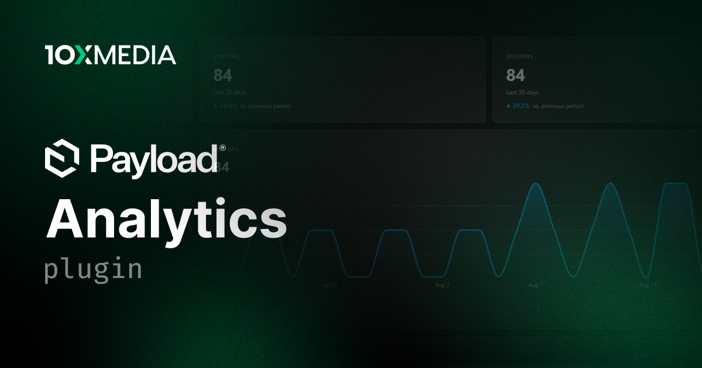

# @10x-media/analytics

Analytics for Payload v3 behind one adapter contract: a self-hosted native engine that stores hits in your own database, or GA4, Plausible, Umami and PostHog, read through an analytics view, dashboard widgets and per-document stat fields. Every surface hides what the active source cannot answer.

[](https://www.npmjs.com/package/@10x-media/analytics)

Part of the [@10x-media Payload plugins](https://github.com/10x-media/payload-plugins) collection. In beta: published under the `beta` dist-tag until a stable 1.0.

## What it does

- **Native engine**: cookieless analytics in your own MongoDB, Postgres or SQLite database, counted into exact daily totals, with visits, bounce rate, geo and bot filtering.
- **Providers**: GA4, Plausible, Umami and PostHog as read sources, configured in code or per tenant in the admin, with their trackers served through a first-party proxy (GA4 excepted).
- **Capture**: a small browser tracker, goals and revenue from markup, forms and server code, and a signed link that keeps staff out of the numbers.
- **Admin**: an analytics view at `/admin/analytics`, widgets for Payload's dashboard, and stat fields on your own collections.
- **Multi-tenancy**: one scope per tenant, from capture to every read.

Consent is the site's decision, not the plugin's: it stores no consent state, and your consent manager opens and closes capture through `setGate`.

## Install

```bash
pnpm add @10x-media/analytics @10x-media/fields
```

It needs Payload `^3.83.0`, Next.js `^15.2.9` or `^16.2.6`, React 19 and Node.js 22.18 or later. `@10x-media/fields` is a required peer.

```ts
// payload.config.ts
import { analytics, analyticsDefaultWidgets } from '@10x-media/analytics'
import { native } from '@10x-media/analytics/adapters/native'
import { mongooseAdapter } from '@payloadcms/db-mongodb'
import { buildConfig } from 'payload'

export default buildConfig({
  db: mongooseAdapter({ url: process.env.DATABASE_URL ?? '' }),
  secret: process.env.PAYLOAD_SECRET ?? '',
  admin: {
    dashboard: { widgets: [], defaultLayout: [...analyticsDefaultWidgets()] },
  },
  plugins: [
    analytics({
      adapters: [native()],
      // Required, and your decision: 'off' captures at once, 'all' holds every capture slot
      // until your consent manager calls setGate (see Consent), so it counts nothing without one.
      capture: { gate: 'off' },
      collections: {
        pages: { path: (doc) => (typeof doc.slug === 'string' ? `/${doc.slug}` : null) },
      },
    }),
  ],
})
```

Then regenerate the types and the import map (`pnpm payload generate:types`, `pnpm payload generate:importmap`) and render `<AnalyticsScripts>` from `@10x-media/analytics/site` in your site's root layout, `app/(frontend)/layout.tsx` in a Payload app. The [quick start](https://docs.10xmedia.de/analytics/quick-start) walks through each step, and what the boot logs.

## Documentation

Full documentation at [docs.10xmedia.de/analytics](https://docs.10xmedia.de/analytics):

- [Quick start](https://docs.10xmedia.de/analytics/quick-start)
- [Concepts](https://docs.10xmedia.de/analytics/concepts)
- [Consent](https://docs.10xmedia.de/analytics/consent)
- [Providers](https://docs.10xmedia.de/analytics/providers)
- [Multi-tenancy](https://docs.10xmedia.de/analytics/multi-tenancy)
- [Privacy](https://docs.10xmedia.de/analytics/privacy)
- [Options reference](https://docs.10xmedia.de/analytics/reference/options)

Upgrading from 1.0.0-beta.11 changes options, endpoints and storage: follow [From 1.0.0-beta.11](https://docs.10xmedia.de/analytics/upgrading/beta-12) before you deploy it.

## License

[MIT](./LICENSE). Copyright 10x Media GmbH.
