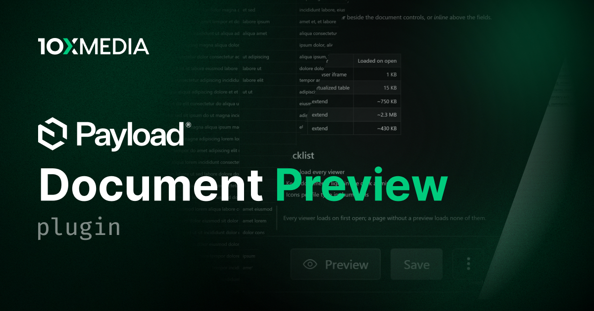

# @10x-media/document-preview

> [!IMPORTANT]
> **This is the Payload v4 branch.** It targets Payload `4.0.0-beta` on Next.js and TanStack Start and is released under the `alpha` tag (`pnpm add @10x-media/document-preview@alpha`). The Payload v3 version lives on [`main`](https://github.com/10x-media/payload-plugins/tree/main/packages/document-preview) and is released as `latest`.
>
> Found a problem with the v4 version? Please [open an issue](https://github.com/10x-media/payload-plugins/issues/new?labels=v4) with the **`v4`** label.

Read-only previews of upload documents in the Payload 4 admin. Word, Excel, PowerPoint, CSV, text and code and Markdown open in viewers styled like the admin, in the edit view's file panel or, from a list column, in a drawer; images, video, audio and PDF too, if you want the plugin's viewers for them over Payload's own. Everything renders in the browser and loads only when a file of its kind is opened.

[](https://www.npmjs.com/package/@10x-media/document-preview)

Part of the [@10x-media Payload plugins](https://github.com/10x-media/payload-plugins) collection. In alpha on this branch: published under the `alpha` dist-tag until Payload 4 is stable.

## Features

- **Every common format**: images with zoom and pan, native video and audio, PDF through the browser's viewer, CSV and TSV in a table virtualized on both axes, text and code in Payload's code editor, rendered Markdown with GFM tables.
- **Office documents in the browser**: Word with a page rail, Excel with formulas, a formula bar and sheet tabs, PowerPoint with a slide rail, through extend's WebAssembly renderers. No server conversion.
- **In Payload's file panel**: the viewer replaces the file panel's preview for the types Payload cannot show, or for every type with `nativePreviews: false`. A Preview column in the list view opens a drawer; `DocumentPreview` and `PreviewDrawer` for your own components.
- **Lazy by format**: each viewer is its own chunk, fetched on first open. Pages that never open a preview load none of them.
- **Custom viewers**: replace the viewer for any mime type, per collection or globally, with your own component.
- **File-type icons** for non-image thumbnails across the admin, plus icons of your own, served to signed-in users only.
- **Readable file sizes** in the list view.
- Typed translations with per-key overrides via `@10x-media/document-preview/i18n`.

## Quick start

```bash
pnpm add @10x-media/document-preview@alpha
```

```ts
// payload.config.ts
import { buildConfig } from 'payload'
import { documentPreview } from '@10x-media/document-preview'

export default buildConfig({
  // ...
  plugins: [
    documentPreview({
      collections: {
        media: { listView: true },
      },
    }),
  ],
})
```

Then regenerate the import map and open a document of the collection: the file panel beside the fields shows the file.

## Documentation

Full documentation at [docs.10xmedia.de](https://docs.10xmedia.de/document-preview):

- [Overview](https://docs.10xmedia.de/document-preview)
- [Quick start](https://docs.10xmedia.de/document-preview/quick-start)
- [Surfaces](https://docs.10xmedia.de/document-preview/surfaces)
- [Viewers](https://docs.10xmedia.de/document-preview/viewers)
- [Custom viewers](https://docs.10xmedia.de/document-preview/custom-viewers)
- [File icons](https://docs.10xmedia.de/document-preview/file-icons)
- [Production](https://docs.10xmedia.de/document-preview/production)
- [Configuration](https://docs.10xmedia.de/document-preview/configuration)
- [i18n](https://docs.10xmedia.de/document-preview/i18n)
- [Upgrading to Payload 4](https://docs.10xmedia.de/document-preview/upgrading)

## License

[MIT](./LICENSE). Copyright 10x Media GmbH.
