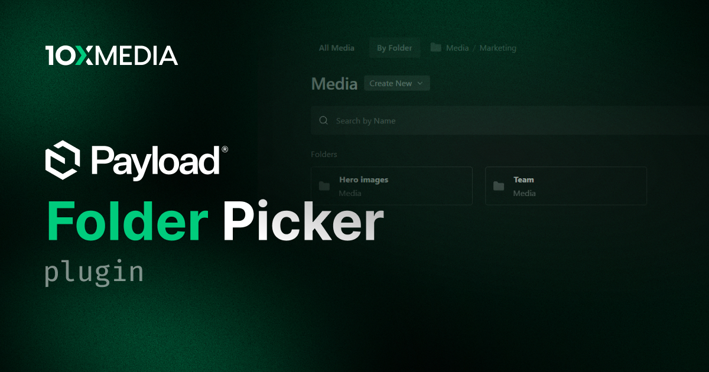

# @10x-media/folder-picker

> [!IMPORTANT]
> **This is the Payload v4 branch.** It targets Payload `4.0.0-beta` on Next.js and TanStack Start and is released under the `alpha` tag (`pnpm add @10x-media/folder-picker@alpha`). The Payload v3 version lives on [`main`](https://github.com/10x-media/payload-plugins/tree/main/packages/folder-picker) and is released as `latest`.
>
> Found a problem with the v4 version? Please [open an issue](https://github.com/10x-media/payload-plugins/issues/new?labels=v4) with the **`v4`** label.

Folder browsing inside Payload's list drawer, so any field picks documents by folder. Payload 4 browses folders on the collection route, but open the same collection from an upload field's "choose from existing" and you get a flat, paginated list. This plugin puts the folders back, for every field that opens a drawer.

[](https://www.npmjs.com/package/@10x-media/folder-picker)

Part of the [@10x-media Payload plugins](https://github.com/10x-media/payload-plugins) collection. In alpha on this branch: published under the `alpha` dist-tag until Payload 4 is stable.

## Features

- **One view swap, every caller**: upload fields, `hasMany` uploads, relationship fields with `appearance: 'drawer'`, and the lexical upload node, without patching a single field.
- **Payload's own folder view in the drawer**: the hierarchy view the collection route shows, with subfolder navigation, a trail back up, and search, none of which leaves the document being edited.
- **Create without leaving**: a new folder or document from the drawer, filed into the folder being viewed. Moving and deleting stay on the collection route; the drawer only picks.
- **Picking like the list tab**: a click on a name picks for a single field; `hasMany` fields tick documents and **Confirm**.
- **Only the folders that fit**: folders of a collection-specific folder collection are filtered to the drawer's collection, and documents the field already holds are left out.
- **Polymorphic fields switch collection in place**, through the same collection select the list tab carries.
- **Bulk upload into the current folder** for `hasMany` fields.
- **The list route stays Payload's**: outside a drawer the collection renders exactly as before.
- **Respects host customization**: collections that already declare a list view are never overwritten, and collections without a folder field keep the stock drawer.

## Quick start

```bash
pnpm add @10x-media/folder-picker@alpha
```

```ts
// payload.config.ts
import { buildConfig, createFolderField } from 'payload'
import { folderPicker } from '@10x-media/folder-picker'

export default buildConfig({
  collections: [
    {
      slug: 'folders',
      admin: { useAsTitle: 'name' },
      folders: true,
      fields: [{ name: 'name', type: 'text', required: true }],
    },
    { slug: 'media', upload: true, fields: [createFolderField({ relationTo: 'folders' })] },
  ],
  plugins: [folderPicker({})],
})
```

Then run `payload generate:importmap`, or the swapped view will not resolve. Open any document with an upload field pointing at `media` and the drawer gains a **By Folder** tab.

## Documentation

Full documentation at [docs.10xmedia.de](https://docs.10xmedia.de/folder-picker):

- [Overview](https://docs.10xmedia.de/folder-picker)
- [Quick start](https://docs.10xmedia.de/folder-picker/quick-start)
- [Configuration](https://docs.10xmedia.de/folder-picker/configuration)
- [Limits](https://docs.10xmedia.de/folder-picker/limits)
- [i18n](https://docs.10xmedia.de/folder-picker/i18n)
- [Upgrading to Payload 4](https://docs.10xmedia.de/folder-picker/upgrading)

## License

[MIT](./LICENSE). Copyright 10x Media GmbH.
